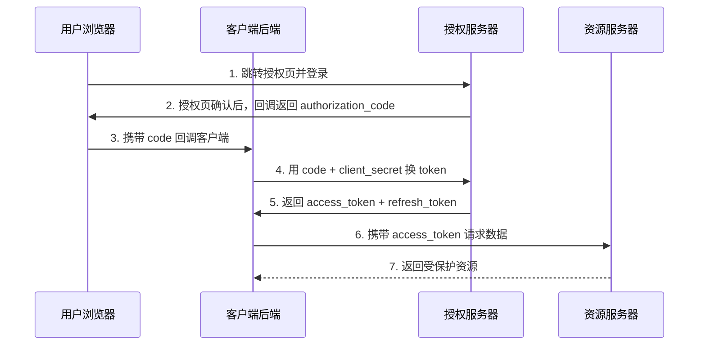

# OAuth 2.0 认证方式详解

> OAuth 2.0（RFC 6749）是一个
>
> **授权框架**
>
> （Authorization Framework），核心思路是：让应用（客户端）在
>
> **不拿到用户密码**
>
> 的情况下，获得访问用户资源的 "通行证"（Access Token）。严格来说 OAuth 2.0 解决的是 "授权" 问题，但实践中常被当作认证方案使用。

## 1. 核心角色


| 角色    | 英文                   | 说明         | 例子        |
| ----- | -------------------- | ---------- | --------- |
| 资源所有者 | Resource Owner       | 拥有数据的人     | 登录微信的用户   |
| 客户端   | Client               | 请求访问资源的应用  | 第三方网站 App |
| 授权服务器 | Authorization Server | 发令牌的地方     | 微信开放平台    |
| 资源服务器 | Resource Server      | 存数据、验令牌的地方 | 微信 API 服务 |

## 2. 三种关键凭据


| 凭据                      | 作用                   | 有效期           |
| ----------------------- | -------------------- | ------------- |
| Authorization Code（授权码） | 一次性换取令牌的凭证，短命        | 几分钟           |
| Access Token（访问令牌）      | 调用资源服务器 API 时携带      | 较短（如 1\~2 小时） |
| Refresh Token（刷新令牌）     | Access Token 过期后换新令牌 | 较长（天 / 月级）    |


***

## 3. 五种标准授权模式（RFC 6749）

### 3.1 授权码模式（Authorization Code Grant）⭐ 最常用、最安全

**适用场景**：有后端服务器的 Web 应用（如 FastAPI + 前端网页）。

**流程**：




**要点**：


* 授权码只走**后端**交换令牌，令牌不会暴露在浏览器

* 客户端必须持有 `client_secret`，安全性最高

* 授权码只能使用一次，且要与 `redirect_uri` 严格匹配

### 3.2 授权码 + PKCE 模式（Authorization Code + PKCE）⭐ 移动端 / SPA 首选

**为什么需要**：纯前端应用（SPA）和移动 App 无法安全保存 `client_secret`，传统授权码模式有被拦截风险。

**PKCE 核心**：客户端先生成 `code_verifier`（随机串），推导出 `code_challenge` 随授权请求发出；换令牌时带上原 `code_verifier`，授权服务器校验两者匹配，从而证明请求者就是授权发起者。

**流程差异**：与授权码模式基本相同，只是授权请求额外带 `code_challenge`，换令牌时带 `code_verifier`。

**现状**：OAuth 2.1 已要求**所有场景**（含 Web 后端）默认使用 PKCE。

### 3.3 隐式模式（Implicit Grant）⚠️ 已废弃

**适用场景**：早期纯前端应用（无后端）。

**流程**：授权服务器在回调 URL 中**直接返回 access\_token**，跳过授权码交换环节。

**缺点**：


* 令牌暴露在浏览器 URL 中，易被窃取（历史、referer 泄露）

* 无 Refresh Token 机制

* **OAuth 2.1 已正式移除该模式**，一律改用 "授权码 + PKCE"

### 3.4 密码模式（Resource Owner Password Credentials，ROPC）⚠️ 不推荐

**适用场景**：用户直接向客户端提交用户名密码（如同一厂商的 App 登录其自家服务、遗留系统迁移）。

**流程**：


```
客户端 ←——— 用户提交 username + password ———→ 授权服务器

客户端 ←———————————————— access\_token ————————→ 授权服务器
```

**缺点**：


* 客户端直接接触用户明文密码，违背 OAuth2"不暴露密码" 的初衷

* 无法做 MFA、无法撤销单次授权

* **OAuth 2.1 已移除**；FastAPI 官方文档示例虽然用此模式演示，但生产环境应改用授权码模式

### 3.5 客户端凭证模式（Client Credentials Grant）⭐ 服务间通信

**适用场景**：没有用户参与的机器对机器（M2M）通信 —— 后端服务调用另一个服务、定时任务、运维脚本。

**流程**：


```
客户端 ←——— client\_id + client\_secret ————→ 授权服务器

客户端 ←———————————— access\_token ————————→ 授权服务器

客户端 ←———— access\_token ————→ 资源服务器
```

**要点**：


* 令牌代表 "客户端自身"，不代表某个用户

* 一般配合 `scope` 限定权限（如只读、只写）

* 拿不到 Refresh Token 也没关系，直接用凭证再换即可


***

## 4. 扩展模式

### 4.1 刷新令牌（Refresh Token）


* 不是独立的授权模式，而是**令牌续期机制**

* Access Token 过期后，客户端用 Refresh Token 静默换新令牌，用户无需重新登录

* 安全要求：存储在服务端，不在浏览器暴露；可被吊销

### 4.2 设备授权流（Device Authorization Grant）

**适用场景**：智能电视、智能音箱、IoT 设备等无法方便输入密码的设备。

**流程**：


1. 设备显示一个 URL 和用户码（如 `ABCD-EFGH`）

2. 用户用手机 / 电脑访问该 URL 并输入用户码完成登录

3. 设备轮询授权服务器，登录成功后获得令牌


***

## 5. 五种模式速查对比


| 模式         | 有用户参与  | 需要 client\_secret | 令牌传输路径      | 适用场景      | 现状             |
| ---------- | ------ | ----------------- | ----------- | --------- | -------------- |
| 授权码模式      | ✅      | ✅                 | 后端换令牌       | Web 应用    | 推荐             |
| 授权码 + PKCE | ✅      | ❌                 | 后端换令牌 + 校验  | SPA / 移动端 | **首选（2.1 强制）** |
| 隐式模式       | ✅      | ❌                 | 浏览器 URL 直接给 | 旧版纯前端     | 已废弃            |
| 密码模式       | ✅      | ✅                 | 客户端直接拿密码换   | 自家信任服务    | 不推荐            |
| 客户端凭证模式    | ❌      | ✅                 | 后端换令牌       | 服务间通信     | 推荐             |
| 设备授权流      | ✅（另设备） | 视情况               | 用户码轮询       | IoT / 电视  | 推荐             |

## 6. 如何选择


```
有没有"用户"这个角色？

├── 没有（服务间调用）→ 客户端凭证模式

└── 有

&#x20;   ├── 前端是网页/App，且无后端 → 授权码 + PKCE

&#x20;   ├── 前端是网页/App，且有后端 → 授权码模式（建议也加 PKCE）

&#x20;   ├── 是智能电视/无输入设备 → 设备授权流

&#x20;   └── 自家高度信任的遗留系统 → 密码模式（尽量迁移）
```

**一句话选型**：


* **2026 年的默认答案 = 授权码 + PKCE**，几乎覆盖所有 "有用户" 的场景

* 服务间通信用**客户端凭证模式**

* 其余三种模式（隐式、密码）已退出主流，仅在遗留系统中维护

## 7. 安全要点


* **HTTPS 是前提**：所有端点必须走 HTTPS，否则令牌可被中间人窃取

* **Access Token 有效期要短**（分钟～小时级），配合 Refresh Token 续期

* **Redirect URI 白名单校验**：防止授权码被重定向到攻击者

* **Scope 最小化**：只申请必要权限

* **令牌不要放 URL / 日志 / 前端存储**：前端优先放内存，Refresh Token 尽量只在后端

* **支持令牌吊销**：泄露或离职场景能立即失效

## 8. 在 FastAPI 中的落地

FastAPI 内置 `OAuth2PasswordBearer`、`OAuth2PasswordRequestForm` 等工具，配合 `python-jose` 可快速实现令牌签发与校验：


```
from fastapi.security import OAuth2PasswordBearer

from jose import jwt

oauth2\_scheme = OAuth2PasswordBearer(tokenUrl="token")

\# 签发

token = jwt.encode({"sub": user.id, "exp": expire}, SECRET\_KEY, algorithm="HS256")

\# 校验（依赖注入）

async def get\_current\_user(token: str = Depends(oauth2\_scheme)):

&#x20;   payload = jwt.decode(token, SECRET\_KEY, algorithms=\["HS256"])

&#x20;   ...
```

> 注意：FastAPI 官方教程示例用 "密码模式" 演示，仅用于教学；生产环境请按上文选型改用授权码 + PKCE 或对接成熟的 OAuth2 服务商（如 Auth0、Keycloak、飞书 / 微信开放平台）。


***

*参考标准：RFC 6749（OAuth 2.0）、RFC 7636（PKCE）、RFC 8628（Device Authorization Grant）、OAuth 2.1 草案*