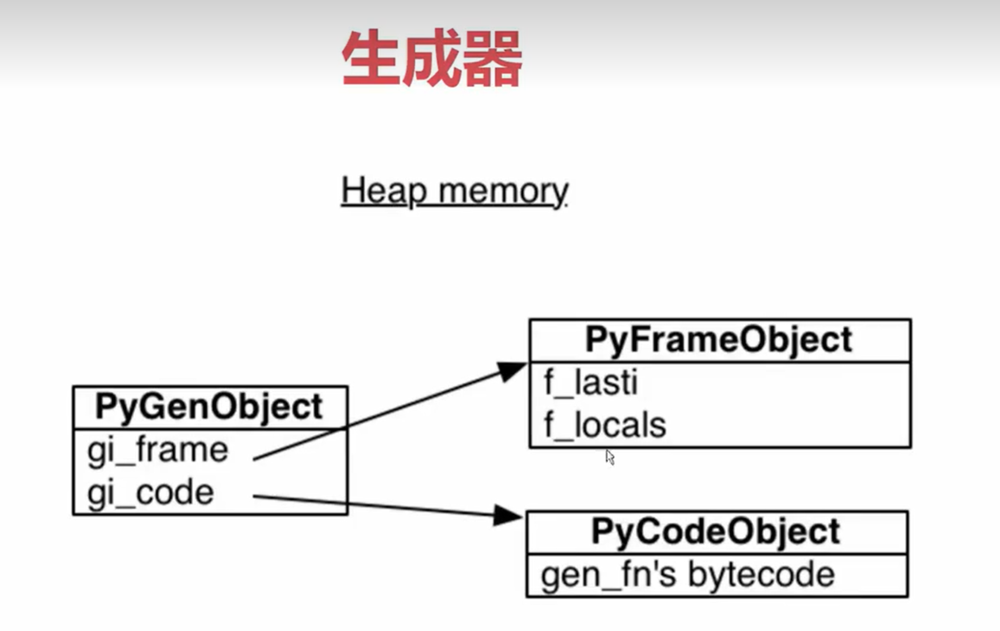

# Python 生成器函数与栈帧详解

> 围绕两个问题:① 什么是生成器函数,怎么用;② 生成器为什么能"暂停再继续"——答案藏在 Python 的栈帧对象与堆分配机制里。第二个问题是第一个问题的底层原理,合起来正好是"从用法到实现"的完整链路。

---

## 一、生成器函数

### 1.1 一句话概括

**生成器函数是包含 `yield` 关键字的函数**。它和普通函数最大的区别:普通函数一执行就一口气跑完并返回结果,而生成器函数被调用时**不会执行函数体**,而是返回一个生成器对象,函数体在每次向它要值时才"走一步"。

```python
def count_down(n):
    while n > 0:
        yield n        # 产出一个值,然后暂停在这里
        n -= 1

gen = count_down(3)   # 此时函数体一行都没执行
print(next(gen))      # 输出 3,执行到第一个 yield 后暂停
print(next(gen))      # 输出 2,从暂停处继续
print(next(gen))      # 输出 1
print(next(gen))      # 抛出 StopIteration,因为函数体跑完了
```

### 1.2 暂停/续跑的执行流程

每次调用 `next()`(或用 `for` 循环迭代),代码从上一次暂停的位置继续执行,直到遇到下一个 `yield` 就把值交出去并再次暂停。函数结束时抛出 `StopIteration`,`for` 循环会自动捕获它,所以日常用 `for i in count_down(3)` 就行。

和 `return` 类比着记最直观:**`return` 是"把东西全部给你然后函数没了",`yield` 是"给你一个,我站在这儿等你下次再来拿"**。

### 1.3 两个典型用途

**1. 惰性生成、省内存。** 值是按需产生的,而不是先全部放进一个列表。比如读取大文件:

```python
def read_lines(path):
    with open(path, encoding="utf-8") as f:
        for line in f:
            yield line.strip()   # 一次只占一行的内存
```

如果文件有几 GB,用列表一次读入会爆内存,而生成器任何时候只保存"当前处理到哪了"的状态。生成无限序列(比如不断产生随机数)也只能靠生成器,列表做不到。

**2. 值只在需要时才算出来。** 如果生成的代价很高而你可能只用前几个值,生成器会跳过用不到的计算。

### 1.4 FastAPI 场景:`yield` 依赖项的清理逻辑

在 FastAPI 里 `yield` 还有另一个重要用途——依赖项中 `yield` 之前的代码在请求处理前执行(如打开数据库会话),`yield` 之后的代码在请求结束后执行(如关闭会话):

```python
async def get_db():
    db = SessionLocal()
    try:
        yield db            # 把 db 交给路径函数使用
    finally:
        db.close()          # 请求结束后一定会执行
```

---

## 二、生成器为什么能暂停:栈帧对象
> 也就是说每次yield时，会把栈帧的快照保存下来
> f_lasti: 指向`最近执行的代码的位置`;
> f_locals： 当执行到f_lasti时，当时的本地变量
> 

### 2.1 一切皆对象:栈帧也是对象

Python 里不光数据是对象,连函数本身、编译后的字节码、甚至"一次函数调用的运行状态"都是对象——这就是"栈帧对象、字节码对象"的含义。

**栈帧(frame)** 是程序每调用一个函数时,解释器为这次调用创建的运行记录,里面保存着:这次调用的局部变量、执行到了字节码的哪一条指令、属于哪个代码对象等。可以理解为"函数调用现场的快照"。

函数嵌套调用时,帧一层层叠上去:调用 `foo` 创建 foo 的栈帧,`foo` 内部调用 `bar` 再为 `bar` 创建一个新栈帧;`bar` 返回后它的帧被销毁,回到 foo 的帧继续执行。

### 2.2 关键区别:帧分配在堆内存上

这是 CPython 和 C/C++ 最本质的区别之一:

| | C/C++ | CPython |
|---|---|---|
| 调用帧放在哪 | 真正的栈上 | 堆内存上(是普通对象) |
| 生命周期规则 | 死板的后进先出,`bar` 的帧必须比 `foo` 的先销毁 | 堆上对象只要还有人引用就能一直活,不受调用顺序约束 |
| 能否"多活一会儿" | 不能 | 可以 |

也就是说,CPython 的栈帧可以**独立于调用者存在**。直接验证:

```python
import sys

def bar():
    return sys._getframe()   # 拿到自己这次调用的栈帧对象

frame = bar()                # bar 已经返回了
print(frame.f_code.co_name)  # 输出: bar —— 栈帧对象还活着
print(frame.f_locals)        # 还能查看它当时的局部变量
```

`bar` 明明已经执行完了,但它的栈帧对象因为我们持有引用而依然存在——这就是"独立于调用者存在"。

### 2.3 回到生成器

现在就能解释生成器的暂停/续跑了:

- 调用 `count_down(3)` 时,解释器创建了栈帧,但**没有**把它压进调用栈,而是让它躺在堆上处于暂停状态;
- `next()` 让它跑一段,遇到 `yield` 就再暂停——局部变量、执行位置都完整保存在这个帧对象里;
- 因为帧在堆上,它想活多久都行,想什么时候恢复就什么时候恢复。

反过来说,如果 Python 像 C 那样把帧放在调用栈上,"函数执行到一半停下、过会儿接着跑"就根本做不到——这也正是 C 语言要实现协程必须额外费很大力气的原因。

---

## 三、总结

- **生成器函数 = 含 `yield` 的函数**,调用返回生成器对象,值按需逐个产出(`next()` 推进、`StopIteration` 收尾),核心价值是惰性求值与省内存;
- **能暂停的原因在底层**:CPython 的栈帧是分配在堆上的对象,不受调用栈后进先出的约束,可以独立于调用者长期存活——`yield` 暂停的其实就是一个躺在堆上的帧对象;
- 与 FastAPI 的联系:`yield` 依赖项(`get_db` 模式)利用"yield 之前是准备、之后是清理"的机制管理请求级资源;`request.stream()`、SQLAlchemy 的 `Result` 等流式接口也都基于生成器/迭代器协议工作。
